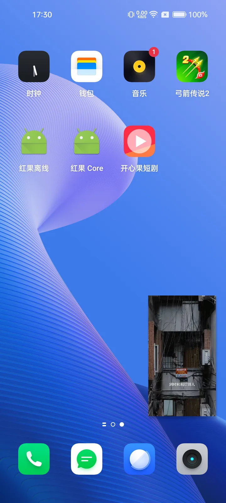

# 开心果短剧 Native

`pistachio-drama-android`

基于 Java 与 Media3 的原生 Android 短剧客户端。

[](https://developer.android.com)
[](https://openjdk.org)
[](https://developer.android.com/media/media3)
[](CHANGELOG.md)
[](https://github.com/husanpao/pistachio-drama-android/actions/workflows/android.yml)

## 功能

- 全屏竖滑 Feed，自动播放，上下滑换剧
- 真人剧、漫剧、AI 漫剧混合推荐
- 本地偏好排序、观看历史、继续观看
- 剧场筛选、排行榜、新剧、搜索
- Media3 播放器：PiP、倍速、清晰度、选集、自动连播
- 当前集缓存，顺序预缓存后 3 集
- 应用内检查 GitHub Release 更新
- 游客身份，无账号、金币、广告、推送和遥测

## 截图

| 推荐 | 剧场 | 排行榜 |
|---|---|---|
|  |  |  |

| 详情 | 播放器 | 小窗 |
|---|---|---|
|  |  |  |

## 环境

- JDK 17+
- Android SDK Platform 34、Build-Tools 34.0.0
- Android 8.0+ 真机或模拟器

## 构建

```powershell
cd android
.\gradlew.bat assembleDebug
```

首次构建需要联网下载 AndroidX 与 Media3 依赖。生成的 APK：

```text
android/app/build/outputs/apk/debug/app-debug.apk
```

Release 请执行 `assembleRelease`，并使用自己的 keystore 签名。
[`artifacts/app-release.apk`](artifacts/app-release.apk) 仅用于侧载验证，不是商店签名。

## 安装

```powershell
adb install -r artifacts/app-release.apk
adb shell am start -n com.hongguo.nativeapp/com.hongguo.core.SplashActivity
```

如果设备上已有不同签名的版本：

```powershell
adb uninstall com.hongguo.nativeapp
adb install artifacts/app-release.apk
```

## 自动构建与更新

GitHub Actions 会在 push / PR 时构建 debug 与 unsigned release APK，并上传为构建产物。
每次 push 到 `main` 还会检查 `build.gradle.kts` 中的版本号：如果该版本还没有 GitHub
Release，会自动构建签名 APK、创建 tag / Release，并更新 `update.json`。

版本号仍由 `android/app/build.gradle.kts` 的 `versionName` / `versionCode` 决定。
创建自动 Release 前需配置以下 Secrets：

```text
ANDROID_KEYSTORE_BASE64
ANDROID_KEYSTORE_PASSWORD
ANDROID_KEY_ALIAS
ANDROID_KEY_PASSWORD
```

应用启动后会静默检查最新版本（找不到时回退到 Tags），也可在「我的 → 检查更新」
手动触发。检查优先使用 `update.json` 的国内可访问镜像，发现新版本时打开镜像下载页。

## 免责声明

本项目为非官方、非商业的个人学习与协议研究项目，与任何内容提供方均无关联。
请仅访问你有权访问的内容，并遵守相关服务条款与法律法规。

仓库不包含私有签名库、账号或受版权保护的视频文件。
公开源码摘录仅作本地研究，不随仓库分发；其版权归原作者所有。本项目未授予开源许可证。
